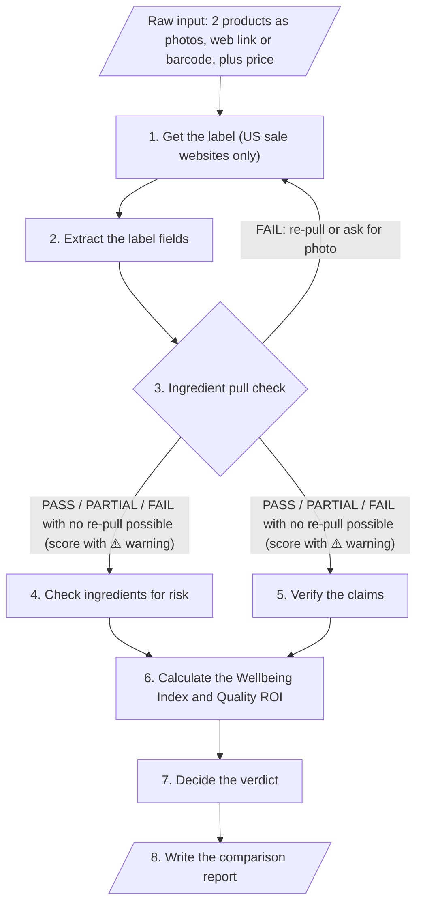

# Process Flow: Know Your Product, Wellbeing Comparison

This is the pipeline from raw input to the finished comparison report, in eight steps. It was designed by working backwards from the output; it runs forwards from step 1.

## Steps

| # | Step | Input | Output | Reference file |
|---|---|---|---|---|
| 1 | **Get the label** | **Raw input:** two products as photos (front and back), a web link or barcode, or both; a price for each | Label images or label text, pulled in this order: **official NIH label APIs** (DailyMed for OTC drugs, the Dietary Supplement Label Database for supplements), then the **designated product page or other US sale website**, then a **back-label photo** (needed for cosmetics). Source address and date recorded | `reference/05` §10, `reference/06` §1, `reference/02` §7 |
| 2 | **Extract the label fields** | Label images or text (1) | A product record: brand, variant, size, price, claims, full ingredient list in order, active ingredients, nutrition panel, allergens, identifiers, lot number, unreadable parts | `reference/06` §2–5 |
| 3 | **Ingredient pull check** | The product record (2) | PASS / PARTIAL / FAIL, the checks that failed, and the next step. **FAIL → back to step 1** (re-pull or photo). If neither is possible, score with the ⚠️ warning | `reference/06` §6 |
| 4 | **Check ingredients for risk** | The checked ingredient list (3), the flagged-ingredient list, approved sources, FDA recalls and import alerts | A risk tier and authority per ingredient, allergens, watch-points, any score caps → **Ingredient Safety, Additives, Processing Level, Nutrition Balance** scores | `reference/04`, `reference/02`, `reference/05` |
| 5 | **Verify the claims** | Claims and the checked ingredient list (3), the key-terms registry, official registries | A status per claim → **Claim Integrity** score; new terms added to the glossary | `reference/03`, `reference/05` |
| 6 | **Calculate the Wellbeing Index and Quality ROI** | 5 sub-scores (4, 5), caps, price and net quantity in USD | Wellbeing Index 0–100 with band, provisional flag and confidence; Quality ROI | `reference/01` §3–6 |
| 7 | **Decide the verdict** | Both indexes and the gap, Quality ROI, caps, the fit-for-purpose check, incomplete-list warnings, allergens and care groups | The better choice and how strongly (clear winner / leans toward / comparable), trade-offs, who should be careful, in-store tip | `reference/01` §7–8 |
| 8 | **Write the report** | Everything above, plus the source log | The finished comparison report | `reference/07` (examples in `reference/08`) |

## Notes
- **The weakest link is steps 1 → 3.** Every score depends on getting the real ingredient list. Step 3 is the gate that stops a "key ingredients only" pull from reaching the score.
- **Steps 4 and 5 are independent** and can run in parallel; step 6 needs both.
- **Use official APIs first.** DailyMed and the Dietary Supplement Label Database return registered full labels (`reference/05` §10). Cosmetics have no government label database, so they need a back-label photo.
- **Price is a raw input.** Without it, step 6 can't calculate Quality ROI.
